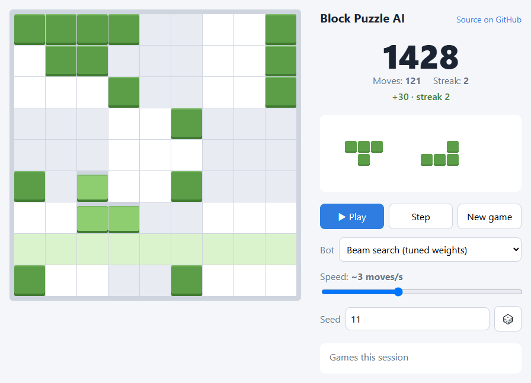
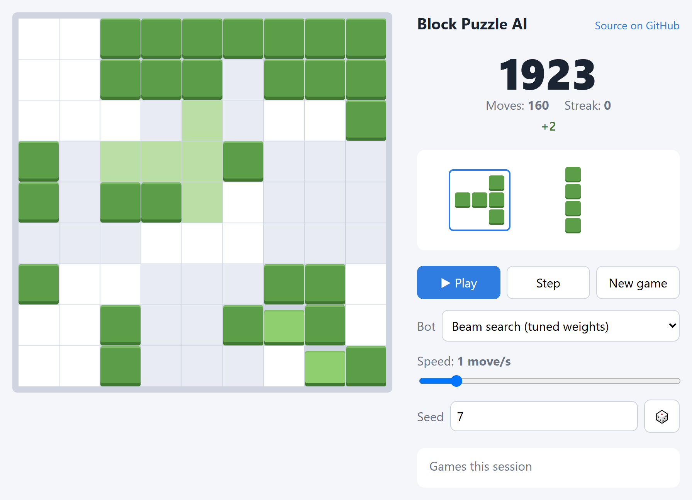
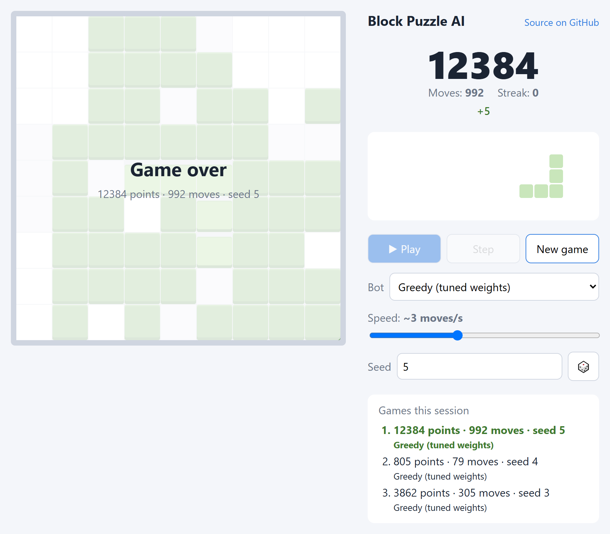

# Block Puzzle AI

[](https://github.com/Glor1us/block-puzzle-ai/actions/workflows/ci.yml)
[](LICENSE)

A 9×9 block-placement puzzle engine in TypeScript and a family of bots that play it, from a random baseline to a
tuned beam search that scores **~1600× more than random** and survives thousands of moves.

**▶ Live demo: [glor1us.github.io/block-puzzle-ai](https://glor1us.github.io/block-puzzle-ai/)**
— watch any bot play, step through its moves or run it in turbo.

<p align="center">
  
</p>

## Results

1000 games per bot on the same seeds ([full table and analysis](bench/RESULTS.md)):

| Bot | Mean score | Median | Mean moves survived |
|---|---|---|---|
| Random | 76 | 56 | 15 |
| Greedy, hand-picked weights | 2 701 | 1 888 | 225 |
| Greedy, tuned weights | 3 740 | 2 731 | 303 |
| Beam search, hand-picked weights | ≥ 61 374 | 42 763 | 4 923 |
| **Beam search, tuned weights** | **≥ 122 996** | **100 951** | **9 799** |

"≥": some games hit the 20 000-move cap while still alive.

## The game
Three pieces are dealt per turn and can be placed in any order. Full rows, columns and 3×3 boxes clear and score.
Clearing several regions at once is a *combo*, and clearing on consecutive placements builds a *streak*
multiplier. Pieces never rotate. The game ends when no piece in the tray fits. Full spec and scoring formula:
[docs/RULES.md](docs/RULES.md).

## Viewer
| Move preview | Game over and session history |
|---|---|
|  |  |

At slow speeds the bot outlines the tray piece it picked and shows the landing cells before it places the piece.
The last placement is highlighted, cleared cells flash, and pieces with no legal spot are drawn faded.

## How the AI works
**1. Heuristic evaluation.** A board is scored as a weighted sum of a few cheap features: filled cells, isolated
holes, filled/empty edges (how ragged the board is), large "probe" shapes that no longer fit anywhere, and tray
pieces left without a legal spot.

**2. Greedy bot.** Tries every legal placement of every tray piece and keeps the one with the best
`points + heuristic`. About 0.1 ms per move. It dies often, because one good-looking placement can leave no room for
the next piece.

**3. Beam search over the tray.** Expands every order × position of the remaining tray pieces, depth by depth,
keeping the best 10 partial plans. Positions reached by different orders are merged with a board hash. The bot
plays the first move of the best complete plan, and plans that strand a piece are only chosen when nothing else
exists. About 1 ms per move, and ~23× the greedy score.

**4. Weight tuning.** A (1+λ) evolution strategy (λ = 12, log-normal mutations, 1/5-style step-size adaptation)
tunes the heuristic weights on 200 training seeds. Games are deterministic per seed, so fitness is noise-free.
Benchmarks run on 1000 *different* seeds: +76% on training seeds vs +38% on held-out ones shows the overfitting
gap. Weights tuned on the fast greedy bot transfer to beam search and double its score.

## Engineering notes
- **Zero runtime dependencies.** The engine, bots and viewer are plain TypeScript and DOM. Dev tooling is
  Vite, Vitest and tsc only.
- **Deterministic and reproducible.** A seeded PRNG (mulberry32) lives inside an immutable `GameState`, so any
  game can be replayed exactly. The browser and Node produce identical results for the same seed.
- **Parallel benchmarking.** `bench/pool.ts` runs games on `worker_threads` with per-game work stealing, because
  game lengths differ by orders of magnitude. About 6× faster on 12 threads.
- **Node runs the TypeScript directly** (native type stripping). The benchmark and tuner need no build step.
- **Tests** (Vitest) cover placement, simultaneous clears, combos, streaks, tray refills and game over.
  Reference-position tests pin the scoring model end to end, and further tests check bot behavior (e.g. beam
  search must outlive greedy on fixed seeds).

## Project layout
```
src/core/   rules engine: pieces, board and regions, immutable game state, configurable scoring, PRNG
src/ai/     board features, bots (random, greedy, beam search), tuned weights, game runner
src/web/    browser viewer (index.html at the root)
bench/      benchmark CLI, weight tuner, worker-thread pool, RESULTS.md
tests/      Vitest suites
docs/       game rules and scoring model
```

## Getting started
Requires Node.js 22.18+ (for native TypeScript execution).

```bash
npm install
npm run dev                                   # viewer at http://localhost:5173
npm test                                      # unit tests
npm run bench -- --bot search-tuned --games 1000
node bench/tune.ts --generations 30 --train 200   # rewrites src/ai/tuned-weights.ts
```

Bots: `random`, `greedy`, `greedy-tuned`, `search`, `search-tuned`.

## Roadmap
- Look ahead into the unknown next tray (expectation over sampled pieces).
- Tune weights directly on beam search, and add features (e.g. near-complete regions).
- Manual play mode and a mobile/PWA layout.

## License
[MIT](LICENSE) © 2026 Vladislav Skobelev
